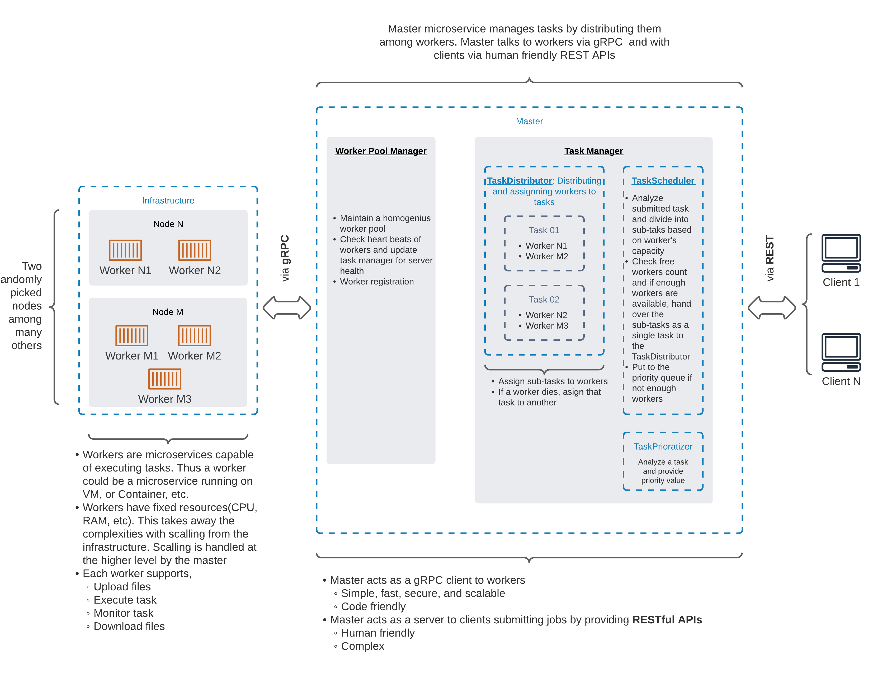
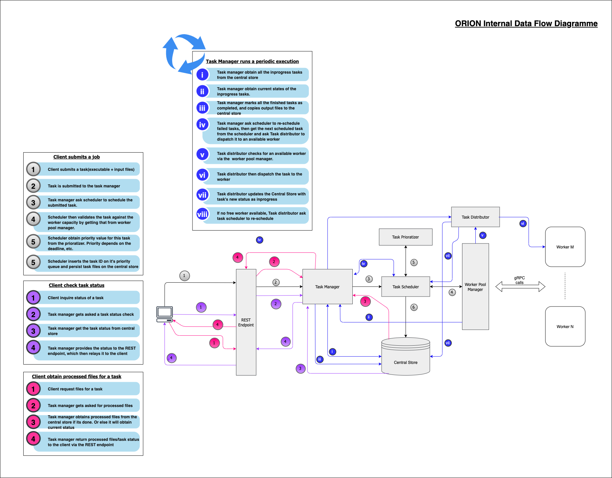

### ORION - A simple, modern, and extensible distributed computing framework built for the cloud.

Orion is a from-scratch implementation of a cloud-native distributed computing system. It was designed with three goals in mind: Simple enough to understand end-to-end, Modern in its use of cloud-friendly protocols and patterns, and Extensible so that it can grow beyond its initial scope.
This repository is the companion code for the [Towards Data Science article](https://medium.com/data-science/lets-build-a-simple-distributed-computing-system-for-modern-cloud-part-one-e2b745126211) — which walks through every design decision in depth.

#### Authors

- [Tharindu Bandara](https://github.com/tharindu-bandara)

---

## Architecture

At a high level, Orion has three major components:

| Component | Role |
|-----------|------|
| **Client** | Users or user agents that submit compute jobs |
| **Master** | Accepts jobs from clients and orchestrates their execution across workers |
| **Worker** | Picks up assigned jobs and executes them |



Communication between components is handled via **gRPC**.
 
---

### Internal data flow diagram

The diagram below shows how data moves through the system once a job is submitted.



---

## Project Structure

```
orion/
├── master/          # Master node — job intake, scheduling, worker orchestration
├── worker/          # Worker node — job execution
├── monitor-app/     # Monitoring dashboard (JavaScript)
├── integration/     # Integration tests + testbed deployment scripts
└── pom.xml          # Maven parent POM
```
 
---

## Getting Started

### Prerequisites

- Java 11+
- Maven 3.6+
- 
### Build

From the project root:

```bash
mvn clean install
```

This compiles all modules — master, worker, and the monitor app. Also, see above-mentioned blog article for a detailed 
guide.
 
---

## Testing

The `integration/` folder contains everything you need to spin up a local testbed and exercise the system end-to-end:

- **A shell script** to deploy all components with a single command
- **A Postman collection** to explore and demonstrate all API capabilities

Refer to the README inside `integration/` for detailed instructions.
 
---

## Tech Stack

- **Java** — core implementation language
- **gRPC / Protocol Buffers** — inter-component communication
- **Maven** — build and dependency management
- **Shell** — testbed automation
- **JavaScript** — monitoring dashboard

---

## License

This project is licensed under the [Apache License 2.0](LICENSE).
 
---